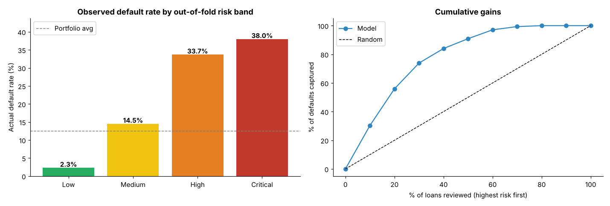
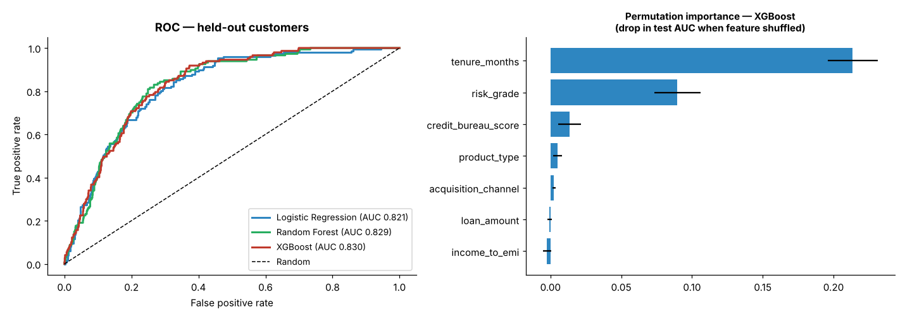
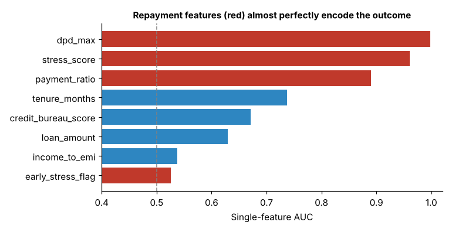

# 💳 Digital Lending – Loan Default & Portfolio Credit Risk Analysis

End-to-end credit-risk analytics for a digital lending portfolio (Personal Loans, BNPL, SME Working Capital): exploratory analysis, feature engineering, default-risk modelling, customer segmentation, and Tableau dashboards.

**Portfolio:** 6,089 loans · 4,941 customers · 12.4% default rate

---

## 🎯 Business questions
- Which borrowers are likely to default *at the time of approval*?
- How should the portfolio be segmented for pricing, limits and monitoring?
- How early can repayment stress be detected on live loans?

---

## 📊 Headline results (leakage-free model)

Evaluated on a **held-out test set split by customer** (no customer appears in both train and test):

| Model | Test AUC | Test PR-AUC |
|---|---|---|
| Logistic Regression | 0.821 | 0.330 |
| Random Forest | 0.829 | 0.343 |
| **XGBoost** | **0.830** | **0.355** |

*(Random-model PR-AUC = default rate ≈ 0.12.)*

Out-of-fold scoring of the full portfolio (5-fold, grouped by customer; AUC 0.824):

| Risk band | Loans | Observed default rate |
|---|---|---|
| Low | 3,045 | 2.3% |
| Medium | 1,826 | 14.5% |
| High | 913 | 33.7% |
| Critical | 305 | 38.0% |

- Reviewing the riskiest **20%** of loans captures **~56%** of all defaults (3× lift in the top decile).
- Most important drivers (permutation importance): **loan tenure**, **lender risk grade**, **credit bureau score**.
- `income_to_emi` added essentially no predictive signal once the other features were included.




---

## ⚠️ Note on data leakage (important)
An earlier version of this project reported **AUC ≈ 0.99** for XGBoost. That number was inflated: the model used repayment-behaviour features (`dpd_max`, `payment_ratio`, `stress_score`) which, for a defaulted loan, largely *are* the default, and it was scored on data it had trained on. `dpd_max` alone has AUC 0.998.

`Phase4_LeakageFree_Model.ipynb` demonstrates this and rebuilds the model using **only information known at origination**, which is what a real approval decision can use. The repayment-based features remain valid for a separate **early-warning / monitoring** use case on already-disbursed loans, but not for approval scoring.



---

## 🗂️ Repository structure
```
Notebooks/
  Phase1_EDA_DigitalLending.ipynb            # EDA, data cleaning, portfolio analysis
  Phase2_FeatureEngineering_DigitalLending.ipynb  # ~25 engineered features
  Phase3_MLModels_DigitalLending.ipynb       # original models + KMeans segmentation (in-sample, see note above)
  Phase4_LeakageFree_Model.ipynb             # leakage demo + honest model + OOF risk bands  ← run this one
Data/
  finalscoredloans.csv                       # original Phase 3 output (in-sample scores; legacy)
  scored_loans_leakage_free.csv              # out-of-fold risk scores & bands per loan
  model_comparison.csv
Images/                                      # charts used in this README
Dashboard/                                   # Tableau workbooks (.twb)
Report/CRO_Report_DigitalLending.docx
```

## 🧠 Methods
- **Segmentation:** KMeans (k = 4) → Prime, Emerging, Stressed, High-Risk Borrowers (Phase 3).
- **Models:** Logistic Regression (scaled), Random Forest, XGBoost with class weighting; customer-grouped train/test split and 5-fold grouped cross-validation.
- **Metrics:** ROC-AUC, PR-AUC (important at a 12% default rate), observed default rate by band, cumulative gains/lift.

## ▶️ Reproducing
```bash
pip install pandas numpy scikit-learn xgboost matplotlib jupyter
cd Notebooks && jupyter notebook Phase4_LeakageFree_Model.ipynb   # runs from Data/finalscoredloans.csv
```
Phases 1–3 read raw input files (`01_customer_profile.csv` … `05_acquisition.csv`) and the Tableau workbooks read `08_tableau_master.csv`; these raw/intermediate files are **not included** in this repository, so Phases 1–3 and the dashboards cannot be re-run from the repo alone. Phase 4 is fully reproducible from the included data.

## ⚠️ Limitations
- Single portfolio snapshot; no out-of-time validation.
- Tenure dominates the model and the lowest-risk deciles contain almost no defaults, so results should be validated on out-of-time data before any real-world use.
- Risk bands are score quantiles (50/80/95th percentile), not calibrated probability cut-offs.

## 🛠️ Tech stack
Python · pandas · NumPy · scikit-learn · XGBoost · Matplotlib · Tableau · Jupyter

## 👩‍💻 Author
Akshita Singh — B.Tech Mechanical Engineering, MNNIT Allahabad
